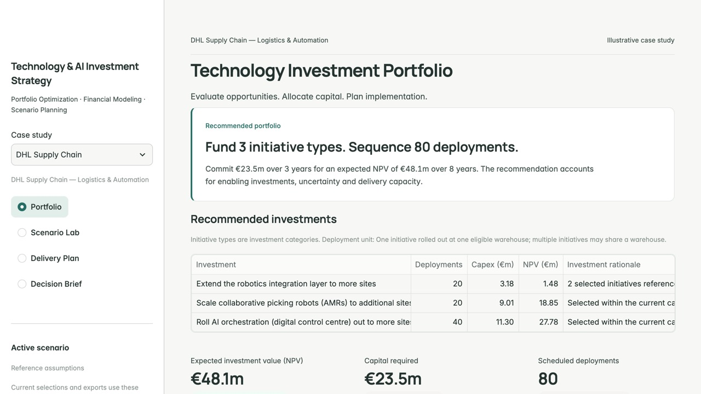
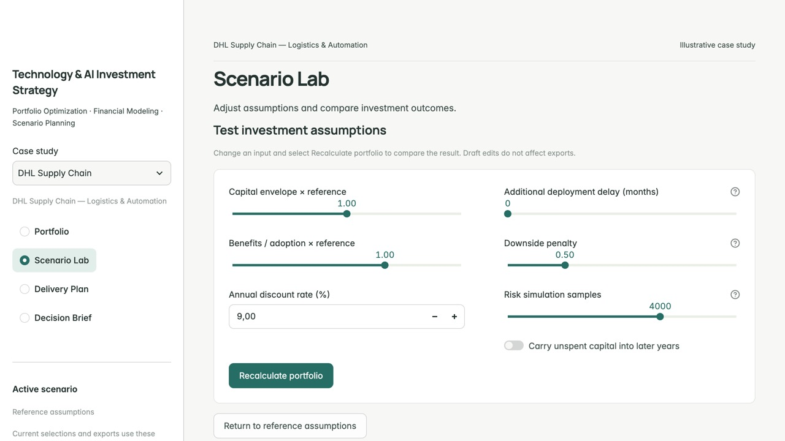
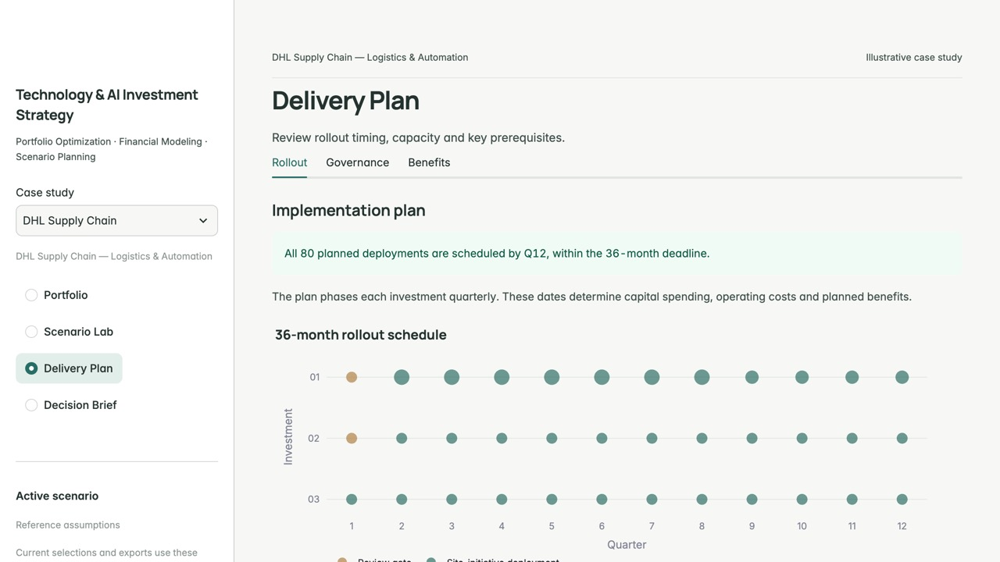
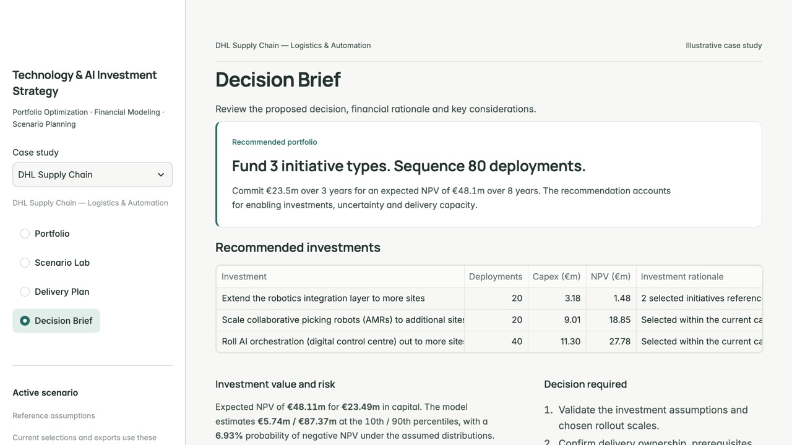
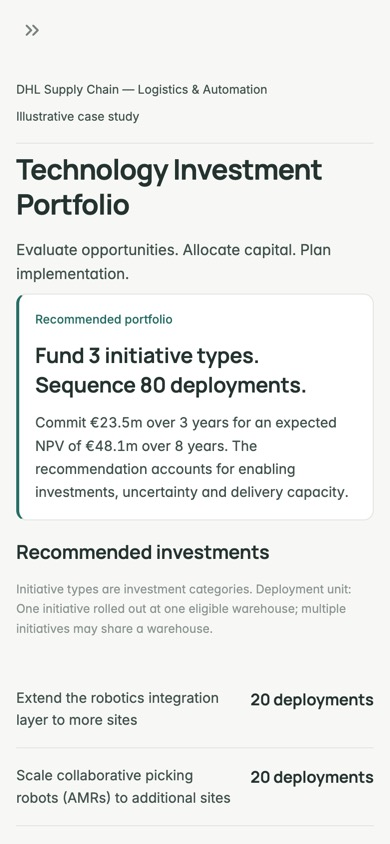
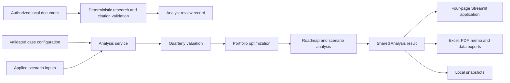

# Technology & AI Investment Strategy

**Portfolio Optimization · Financial Modeling · Scenario Planning**

An interactive technology investment decision platform that compares competing initiatives, optimizes portfolios under financial and resource constraints, plans quarterly delivery, and tracks benefits against targets to support management decisions.

[Launch the live Streamlit application](https://technology-ai-investment-office.streamlit.app/)

The public deployment is an illustrative, session-local demonstration. It requires no secrets or external service credentials, does not persist user uploads or benefit observations, and should not be used for confidential or production data.

Soham Shinde built a reusable Python engine and a four-page Streamlit application that:

- values quarterly investment cash flows under uncertainty;
- selects feasible rollout scales with constrained optimization;
- tests downside assumptions and alternative portfolios;
- reconciles recommendations with a capacity-aware implementation plan;
- produces current Excel, PDF, memo, and supporting data exports; and
- turns authorized PDF, text, or Markdown reports into cited research notes for analyst review.

The product includes three independent, illustrative industry cases:

| Case | Investment decision |
|---|---|
| **DHL Supply Chain — Logistics & Automation** | Warehouse robotics, integration, and orchestration across representative sites |
| **Allianz — Insurance & Financial Services** | Claims operations and customer-service workflow investments |
| **BMW Group — Automotive & Manufacturing** | Industrial AI and digital manufacturing investments across representative production workflows |

The modeled budgets, costs, benefits, probabilities, and returns are hypothetical. Public company sources establish business context and existing capabilities; they do not validate the illustrative economics. This independent project is not affiliated with or endorsed by DHL, Allianz, or BMW Group.



## Product tour

### Scenario analysis



### Quarterly delivery planning



### Management decision brief



### Mobile layout



## Product workflow

| Page | What a decision maker can do |
|---|---|
| **Portfolio** | Review the recommendation, alternatives, evidence, assumptions, and source-linked research notes |
| **Scenario Lab** | Change financial assumptions, recalculate the portfolio, compare choices, and inspect downside scenarios and sensitivity |
| **Delivery Plan** | Assess quarterly rollout capacity, prerequisites, governance checkpoints, and planned versus observed benefits |
| **Decision Brief** | Review the decision rationale, benefits realization, risks, approvals, and export the current analysis as Excel, PDF, Markdown, CSV, JSON, and ZIP |

## Why the project is technically substantial

- **One calculation path:** the dashboard, charts, roadmap, benefits plan, CLI, and exports all consume the same `Analysis` result.
- **Quarterly valuation:** capex, recurring cost, benefit ramp, discounting, staffing, and deployment timing use the same quarterly cohorts.
- **Constrained selection:** OR-Tools CP-SAT enforces capital, annual and quarterly capacity, prerequisites, minimum commitments, mutually exclusive choices, and pilot or governance exclusions.
- **Uncertainty:** seeded Monte Carlo draws model triangular cost and benefit inputs, initiative success, underdelivery, and shared demand.
- **Independent checks:** case audit scripts reconstruct cash flows and enumerate feasible fixed-phasing portfolios rather than trusting the optimizer output alone.
- **State isolation:** switching companies clears scenario drafts, imported actuals, review state, and saved-result feedback.
- **Reproducible exports:** fixed seeds, one solver worker, versioned calculation keys, and deterministic ZIP timestamps support repeatable results.



## Current illustrative results

| Case | Recommended portfolio | Expected NPV | Capital required | P10 / P90 NPV | Last deployment |
|---|---:|---:|---:|---:|---:|
| DHL Supply Chain | 3 initiative types · 80 deployments | €48.11m | €23.49m | €5.74m / €87.37m | Q12 |
| Allianz | 4 initiative types · 22 deployments | €3.94m | €4.58m | −€0.58m / €8.26m | Q6 |
| BMW Group | 5 initiative types · 11 deployments | €3.85m | €3.16m | €0.95m / €6.41m | Q5 |

The Allianz reference case has a negative P10 outcome despite positive expected value. BMW downside scenarios can change the selected rollout scales. The application and exported memo retain these risk signals.

## Run locally

Python 3.13 is used in local validation and CI. The package metadata permits Python 3.11 or later.

```bash
git clone https://github.com/sohamshindework/technology-ai-investment-office.git
cd technology-ai-investment-office
python3.13 -m venv .venv
source .venv/bin/activate
python -m pip install --upgrade pip
python -m pip install -r requirements.txt
python -m streamlit run app.py
```

No API key or external service is required. Streamlit prints the local URL after startup.

Run the verification suite:

```bash
python -m pytest -q --cov=invest_engine --cov=frontend --cov=app --cov-report=term-missing
python -m ruff check .
python scripts/validate_case.py cases/dhl_supply_chain
python scripts/validate_case.py cases/allianz
python scripts/validate_case.py cases/bmw_group
python scripts/evaluate_research.py
python scripts/check_hygiene.py
```

The complete local release suite contains 184 tests and reports 93% combined statement coverage. See [validation](docs/validation.md) for the independent financial, export, benefits, research and clean-environment checks behind those figures.

Exact direct dependencies are in `requirements.txt`; the full tested environment is pinned in `requirements-lock.txt`. The lock is version-pinned rather than artifact-hash-pinned.

## Repository map

```text
app.py                    Streamlit entry point and page dispatch
frontend/                 Shared UI, state, theme, and four-page presentation
invest_engine/            Schema, valuation, optimization, scheduling, reporting
research/                 Reviewed deterministic extraction reference set
cases/                    Three admitted cases plus template and test fixture
scripts/                  CLI exports, independent audits, and hygiene checks
tests/                    Financial, scheduling, UI, export, and isolation tests
docs/                     Architecture, methodology, assumptions, and limitations
assets/                   Current product screenshots and licensed local fonts
```

See [architecture](docs/architecture.md), [financial methodology](docs/methodology.md), [professional exports](docs/professional-exports.md), [case configuration](docs/case-configuration.md), [assumptions](docs/assumptions.md), [validation](docs/validation.md), and [limitations](docs/limitations.md).

## Financial method

Each initiative offers discrete rollout scales, including zero. A cohort completes at quarter end; its deployment capex is paid then, recurring operating cost begins in following quarters, and benefits begin after the configured time-to-value and ramp. Net cash is discounted at quarter-end using the annual case rate.

The optimizer maximizes expected NPV less a downside penalty while enforcing the declared fixed-phasing rollout policy. `OPTIMAL` means optimal for those discrete scales, constraints, and fixed cohort schedules at the stated integer precision. It does not mean that every possible real-world sequence, facility, or contract has been evaluated.

The model excludes taxes, working capital, terminal value, failure contagion, and automatic benefit-overlap adjustments. Capital constraints use expected cost. Operational owners would need to validate eligible deployment units, current capability coverage, incremental benefit pools, cash realization, staffing, and approvals before using any case for a real decision.

## Evidence and governance

Each business-validation document separates published company facts from illustrative assumptions:

- [DHL Supply Chain](cases/dhl_supply_chain/business_validation.md)
- [Allianz](cases/allianz/business_validation.md)
- [BMW Group](cases/bmw_group/business_validation.md)

Governance screening is preliminary. It does not constitute legal advice, compliance certification, or company approval. Review records are local and self-attributed.

## Research workflow

The Portfolio page accepts an authorized PDF, TXT, or Markdown document up to 5 MB. A deterministic parser extracts relevant passages, retains page-level evidence, groups themes, and creates validation questions. The analyst must explicitly accept or reject the draft. Acceptance does not add an initiative, cost, benefit, or assumption to the financial model. Files are processed in Streamlit session state and are not written to application storage or included in committee exports.

The reviewed reference set measures citation verification, expected-passage coverage, schema validity, review behavior, and resistance to instruction-like text. This bounded evaluation is not a claim of general document-understanding accuracy. See [research assistant](docs/research-assistant.md) and [validation](docs/validation.md).

## Benefits realization

Delivery Plan accepts a validated, session-local CSV of quarterly benefit observations. The workflow matches observations to the active company, initiative and reporting period; compares them only with the corresponding plan; reports coverage, variance, confidence and material follow-up; and keeps missing periods unavailable rather than treating them as zero. Observations never change valuation or portfolio selection. Download the in-application template before importing data. See [benefits realization](docs/benefits-realization.md).

## Technology

Python 3.13 · NumPy · pandas · OR-Tools CP-SAT · Streamlit · Plotly · XlsxWriter · ReportLab · PyYAML · Pydantic · pypdf · SQLite · pytest · Ruff

The application runs locally and makes no runtime calls to company systems, research services, or language models. PDF is supported as a research input; the Decision Brief also generates professional Excel analysis workbooks and PDF investment committee reports in memory.

## License and attribution

Application source is provided under the [MIT License](LICENSE), Copyright (c) 2026 Soham Shinde. Inter and Manrope are bundled under the SIL Open Font License 1.1; their notices and source details are in [assets/fonts](assets/fonts/README.md). Public company materials are linked as sources and are not redistributed.
