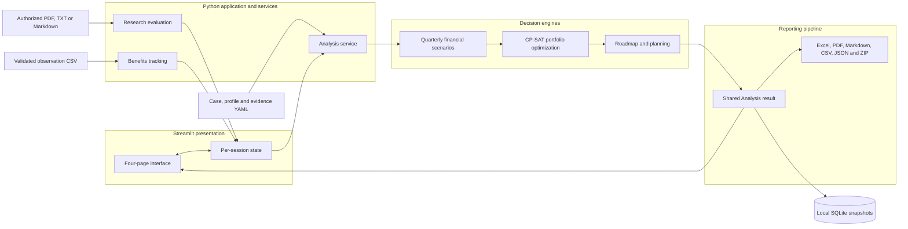
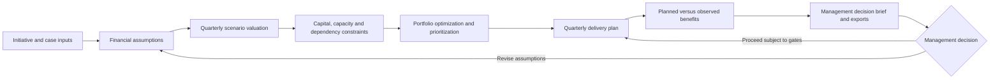
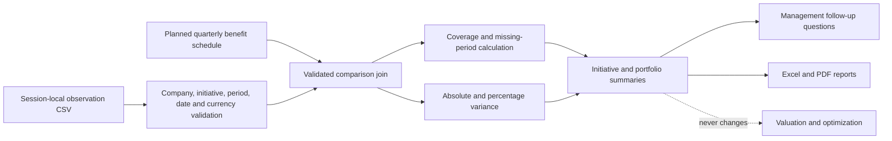

# Architecture

Technology & AI Investment Strategy separates company configuration, financial analysis, and presentation. Domain dataclasses are validated at loading, valuation, and optimization boundaries; malformed YAML raises `CaseError`.

## System architecture

The diagram describes the local application. It does not imply network services, persistent public-user accounts or external company-system integrations.

## Investment decision workflow

## Benefits-realization data flow

`schema.py` owns domain validation; `deployment.py` creates deterministic quarterly cohort/gate/resource vectors; `finance.py` is the only cash-flow calculator. Quarterly vectors are shared with selection, roadmap and benefits. `portfolio.py` owns selection and an independent float feasibility checker. `service.py` applies current assumptions exactly once, then derives every dependent result. `reporting.py` never reads a static memo. `documents.py` formats the same `Analysis` as an in-memory Excel workbook and PDF committee report without reimplementing valuation. `store.py` stores checksummed immutable run bundles and review records. Streamlit handles controls, display and downloads, not financial calculations.

The dashboard cache includes both input-file contents and current settings. Simulation uses a fixed seed, initiative-ID-specific random streams and one shared volume stream; CP-SAT uses one worker. Export ZIP timestamps are fixed for deterministic bytes. SQLite connections close explicitly and writes use transactions and bound parameters.

One local user is the deployment model. A saved review is self-attributed and tied to an exact snapshot. Approving model assumptions does not change a regulatory category, certify compliance or authorize deployment. There are no user accounts, network APIs, LLM integrations or external calls at runtime. Authorized PDF, TXT and Markdown research uploads are parsed in memory and retained only as structured session state; their bytes are not written to application storage or included in financial exports.

The optimizer selects among fixed quarterly rollout options, enforcing deployment/FTE ceilings and temporal dependencies before recommending investment. `roadmap.py` projects the selected cohorts rather than rescheduling them. Cash flows and planned benefits use those exact dates. Annual results aggregate quarters; annual discounted cash flows sum discounted quarterly values. All chosen deployments must fit the original rollout deadline. Flexible start-date optimization remains outside this fixed-phasing model. Calculation-version-aware UI cache keys prevent reuse of the retired annual-model results.

## Presentation layer

The financial/application-service boundary is unchanged. `app.py` handles case/navigation, cached analysis and page dispatch. `frontend/state.py` isolates applied assumptions and review/import state on case changes; draft controls use an explicit form submission. `frontend/components.py` owns formatting, shared recommendations and consistent charts/tables. `frontend/theme.py` centralizes palette tokens for CSS and Plotly; `.streamlit/config.toml` uses matching canvas/text/action colors. `frontend/pages/` contains Portfolio, Scenario Lab, Delivery Plan and Decision Brief plus the retained governance/benefits sections.

The current analysis is passed directly to every export and local record. Excel and PDF generation is session-local and memory-only, applies bounded initiative/quarter/file-size limits, and excludes uploaded research bytes and research proposals. Accepted benefit observations are validated against case, initiative, relative quarter, quarter-end date and EUR currency, then rejoined to matching plan rows before presentation/export. Missing observations remain unavailable. Rows for deferred investments stay in session and are excluded from the active comparison. Observation data never feeds valuation, optimization or planned benefits. Invalid uploads retain the last accepted dataset with an explicit error. The reference scenario has original assumptions; a compact previous-result summary supports comparison without reusing stale financial results. The cache fingerprint still contains calculation version, case bytes and applied configuration.

Manrope and Inter are licensed local fonts. Wide contribution and stress charts and selected-investment tables have compact mobile representations. Company-specific configuration changes labels, KPIs, evidence, governance context and visual accents; it does not introduce a separate financial calculation path.

The flagship case is scoped exclusively to DHL Supply Chain. Company metadata and source titles are separate: DHL Group may be the publisher of reports containing Supply Chain facts, but is not the modeled portfolio owner.

## Research boundary

`invest_engine/research.py` validates size, extension, filename, encoding, PDF structure and structured output. It extracts exact source passages and page numbers, assigns only keyword-based themes, and verifies that every emitted finding is present on the cited page. Instruction-like document text is treated as untrusted content and excluded from findings. Pydantic rejects unexpected output fields and broken evidence references.

`frontend/pages/research.py` embeds the workflow in Portfolio. Approved case sources can supply registered source metadata, but the user must still provide an authorized local copy. Analysts may accept a draft for management validation or reject it, with a required note. Neither state can alter case YAML, optimization inputs, benefits actuals or reporting outputs. Company switching clears upload, proposal and review keys.
